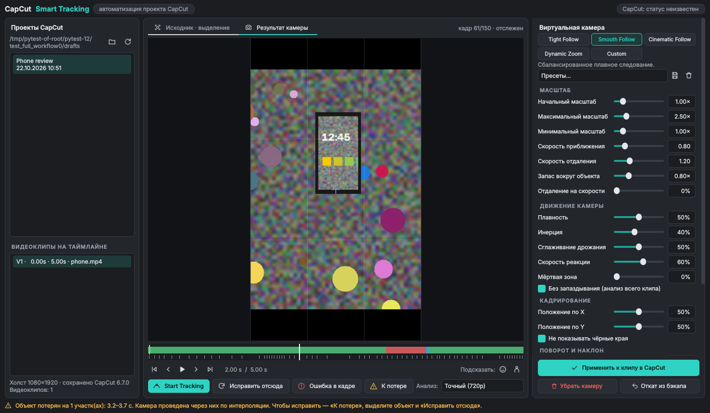

# CapCut Smart Tracking

Инструмент для CapCut Desktop (Windows 10/11). Вы выделяете объект рамкой (телефон, лицо, человека, руку, машину, игрового персонажа), и инструмент автоматически отслеживает его, рассчитывает движение виртуальной камеры с приближением и **записывает ключевые кадры Position / Scale / Rotation прямо в клип вашего проекта CapCut**. Потом вы открываете проект в CapCut и видите готовое движение камеры на таймлайне как обычные ключевые кадры. Их можно редактировать, а итоговое видео экспортируется средствами самого CapCut.



---

## 1. Результаты исследования: можно ли сделать настоящий плагин

| Что проверялось | Результат |
|---|---|
| Официальный SDK плагинов CapCut Desktop | **Нет.** Не нашёл ни портала разработчиков, ни документации, ни SDK для сторонних расширений CapCut Desktop. |
| Своя панель внутри редактора | **Невозможно** без SDK. Встроиться в окно можно только инъекцией кода в процесс, а это запрещено условиями задачи и обходит защиту приложения. |
| Получить выбранный клип и его кадры через API | **Нет API.** Клипы и пути к исходным файлам при этом лежат в открытом JSON-файле проекта. |
| Применять эффекты и параметры клипа | Через файл проекта: поля `clip.scale`, `clip.transform`, `clip.rotation` сегмента. |
| Создавать ключевые кадры | Через файл проекта: список `common_keyframes` сегмента со свойствами `KFTypePositionX/Y`, `KFTypeScaleX`, `KFTypeRotation`. В этих же полях CapCut хранит ключевые кадры, поставленные вручную. |
| Ставить и запускать сторонние плагины | **Нет механизма.** |
| Effect House / эффекты | Это конструктор AR-эффектов. Запустить в нём произвольный код трекинга по выделенной рамке и записать ключевые кадры в ваш клип нельзя. |
| Ограничения Windows-версии | Китайская версия JianYing с 6.0 шифрует `draft_content.json`. По данным сообщества, международный CapCut хранит открытый JSON (pyCapCut проверял сборки 8.2.0 и 9.5.0). Открытый проект CapCut держит в памяти и может перезаписать изменения, сделанные снаружи. |

**Вывод.** Встроенный в интерфейс CapCut плагин сделать нельзя: CapCut Desktop такого не поддерживает. Поэтому я сделал ближайший честный вариант, **автоматизацию проекта**:

* **Это не плагин** в интерфейсе CapCut и **не видеоредактор**. Здесь нет монтажа, рендера и экспорта.
* Это **внешний инструмент** с одной задачей: трекинг объекта и расчёт камеры.
* Результат пишется **в ваш проект CapCut** в виде родных ключевых кадров. Дальше вы работаете только в CapCut.

Действия пользователя: закрыть CapCut → в Smart Tracking выбрать проект и клип → обвести объект → **Start Tracking** → выбрать режим → **Применить** → открыть проект в CapCut.

Скрытые API, инъекция кода и обход шифрования не используются. Если проект зашифрован, инструмент сообщит об этом и откажется записывать.

## 2. Возможности

**Трекинг (основная функция)**
* Отслеживает любую выделенную область алгоритмом OpenCV **CSRT**. Работает не только с лицами: подходит для телефонов, рук, машин, игровых персонажей и чего угодно, что можно обвести рамкой. Следит и за размером объекта (приближение/удаление).
* Для лиц и людей есть автоподсказка рамки: кнопки 🙂 (каскад Хаара) и 🧍 (HOG).
* Трекинг идёт от выбранного кадра **вперёд и назад**, так что объект можно выделить на любом кадре клипа.
* **Потеря объекта:** проверка похожести (NCC с эталоном) и контроль скачков размера. Потерянные участки отмечаются красным на таймлайне, и программа о них сообщает. Пока объект не найден, идёт автоматический повторный поиск (многомасштабный поиск по шаблону). На потерянных участках камера проходит по интерполяции.
* **Исправление ошибок:** кнопка «К потере» переходит к проблемному месту. Там можно обвести объект заново и нажать «Исправить отсюда»: рамка станет опорной точкой (жёлтая метка), и трек пересчитается вперёд до следующей опорной точки. Опорные точки трекер не перезаписывает. Кнопка «Ошибка в кадре» выбрасывает плохой кадр.
* Работает в фоне, с прогрессом и кнопкой «Стоп».

**Автоматическая камера**

| Режим | Алгоритм |
|---|---|
| **Tight Follow** | Жёсткая пружина с высокой реакцией, минимальное сглаживание, плотное кадрирование. |
| **Smooth Follow** | Фильтр Гаусса по цели и пружина средней жёсткости, без запаздывания (прямой и обратный проход). |
| **Cinematic Follow** | Мёртвая зона: камера стоит, пока объект в центральной зоне, потом плавно догоняет. Сильное сглаживание и медленный зум. |
| **Dynamic Zoom** | Масштаб зависит от скорости объекта: в покое камера приближает, при быстром движении отъезжает. |
| **Custom** | Все параметры вручную. Любое изменение параметра режима переключает на Custom. |

Параметры: начальный, максимальный и минимальный масштаб; скорость приближения и отдаления (раздельные ограничители, в удвоениях масштаба в секунду); плавность; инерция; сглаживание дрожания; скорость реакции; положение объекта в кадре (X/Y); запас свободного пространства вокруг объекта; мёртвая зона; режим «без запаздывания»; «не показывать чёрные края» (позиция ограничивается так, чтобы видео закрывало холст).

**Дополнительно**
* Сглаживание траектории и подавление дрожания трека (медианный фильтр + Гаусс).
* Поворот камеры вслед за объектом (вращение оценивается оптическим потоком внутри рамки) и постоянный наклон кадра (dutch angle).
* Прореживание ключевых кадров: многоканальный алгоритм Рамера–Дугласа–Пекера. CapCut интерполирует ключевые кадры линейно, поэтому записывается минимальный набор, который отклоняется от расчётной траектории не больше чем на заданную «Точность» в пикселях.
* Пресеты: 4 встроенных, плюс можно сохранять свои (★).
* Сессии: трек и настройки сохраняются для каждого клипа. При повторном открытии повторный анализ не нужен.
* Бэкап проекта перед каждой записью, «Откат из бэкапа», «Убрать камеру».
* Предпросмотр «Результат камеры» рисуется по той же формуле преобразования, что и записываемые значения. Так вы видите кадр, который соберёт CapCut.

**Не реализовано:** 2.5D-перспектива. В формате ключевых кадров видеосегмента CapCut нет свойства перспективы или угловых точек. Имитировать её нельзя, не выдумывая поля формата, поэтому функции нет.

## 3. Установка (Windows 10/11)

1. Установите **Python 3.10+** с https://www.python.org/downloads/windows/ (отметьте «Add python.exe to PATH»).
2. Скачайте папку `capcut-smart-tracking` и запустите **`install.bat`**. Он создаст окружение `.venv`, установит зависимости и ярлык на рабочем столе.
3. Запуск: ярлык **CapCut Smart Tracking** или `run.bat`.

Автономный .exe без Python: после `install.bat` выполните `build_exe.bat`. Результат появится в `dist\CapCut Smart Tracking\`.

Зависимости (`requirements.txt`): `numpy`, `opencv-contrib-python-headless` (трекер CSRT), `PySide6` (интерфейс).

## 4. Использование

1. **Закройте CapCut** или хотя бы этот проект. Значок в правом верхнем углу показывает, запущен ли CapCut.
2. Слева выберите проект. Папка черновиков находится автоматически (`%LOCALAPPDATA%\CapCut\User Data\Projects\com.lveditor.draft`). Если вы переносили её, укажите путь кнопкой 📁 (в CapCut: Настройки → Черновики).
3. Выберите видеоклип на таймлайне.
4. На вкладке «Исходник» обведите объект мышью (или нажмите 🙂 / 🧍) и нажмите **Start Tracking** (клавиша `T`).
5. Если появились красные участки, нажмите «К потере», обведите объект и выберите «Исправить отсюда».
6. Выберите режим камеры и настройте параметры. Вкладка «Результат камеры» и воспроизведение (`Пробел`, `←` `→`) показывают итог.
7. Нажмите **Применить к клипу в CapCut** и откройте проект в CapCut: у клипа появятся ключевые кадры положения и масштаба (и поворота, если он включён).

## 5. Совместимость

* **ОС:** Windows 10/11 (основная цель). Также запускается на macOS/Linux, но CapCut для Linux нет.
* **CapCut:** международный CapCut Desktop для Windows с **незашифрованным** `draft_content.json`. Формат ключевых кадров совпадает с тем, что пишет библиотека pyCapCut (она проверена сообществом на сборках CapCut 8.2.0 и 9.5.0.4050). Версию CapCut, которая последней сохранила проект, видно под списком клипов (поле `last_modified_platform.app_version`).
* **Не поддерживается:** JianYing 6.0+ и любые сборки, которые шифруют проект. Инструмент это обнаружит и откажется записывать.
* **Я не проверял на реальном CapCut.** Разработка шла в Linux-контейнере без Windows и без CapCut (см. раздел 7). Первый запуск сделайте на копии проекта или проверьте результат сразу. Бэкап создаётся автоматически.

## 6. Структура проекта

```
capcut-smart-tracking/
├── smart_tracking/
│   ├── tracking.py          трекер CSRT, контроль потери, повторный захват, вращение, автоподсказка рамки
│   ├── camera.py            движок виртуальной камеры и 5 режимов
│   ├── capcut_transform.py  модель преобразования клипа CapCut (fit → scale → rotate → position)
│   ├── keyframes.py         прореживание до ключевых кадров CapCut
│   ├── capcut_draft.py      чтение проекта, запись common_keyframes, бэкапы, проверка шифрования
│   ├── storage.py           пресеты и сессии (%APPDATA%\CapCutSmartTracking)
│   ├── video_io.py          чтение кадров (OpenCV/FFmpeg)
│   └── ui/                  интерфейс PySide6: окно, предпросмотр, таймлайн, тема, иконки
├── tests/                   автотесты (синтетическое видео с известной траекторией)
├── install.bat  run.bat  build_exe.bat
└── requirements.txt  requirements-dev.txt
```

Единицы CapCut, используемые при записи: позиция X в половинах ширины холста (вправо +), Y в половинах высоты (вверх +), масштаб 1.0 = вписано в холст, поворот в градусах по часовой стрелке, `time_offset` в микросекундах от начала сегмента на таймлайне.

## 7. Тестирование

Запуск: `pip install -r requirements-dev.txt && python -m pytest tests`

**Выполнено (Linux, Python 3.13, OpenCV 5.0, PySide6 6.12): 37 тестов, все прошли.**

| Проверка | Как | Результат |
|---|---|---|
| Выделение и отслеживание | Синтетическое видео: «телефон» движется по кривой и меняет размер на ±25 %, истинная траектория известна | медианная ошибка центра < 6 px, отслежено > 95 % кадров (720p и 480p) |
| Трекинг назад от середины клипа | Рамка на кадре 75 | оба направления < 6 px |
| Потеря объекта | Объект скрыт на кадрах 60–80 | > 70 % скрытых кадров помечены как потерянные; после возвращения объект найден снова, ошибка < 8 px |
| Опорные точки не перезаписываются | Правка на кадре 40, опорная точка на 100 | сохранена |
| Автоприближение и ограничения | Масштаб в пределах [min, max], старт с начального масштаба, ограничение скорости зума | ✔ |
| Режимы реально различаются | Длина пути камеры: Cinematic < Smooth < Tight; Dynamic отъезжает при быстром движении | ✔ |
| Сглаживание дрожания | Шум 10 px в треке | остаточное дрожание камеры снижено > 30 % |
| Положение объекта в кадре, поворот, отсутствие чёрных краёв | Геометрические проверки | ✔ |
| Математика преобразования | Обратная задача «точка → цель» при масштабе/повороте/отражении, единицы CapCut | ✔ |
| Ключевые кадры | Восстановление линейной интерполяцией в пределах допуска; учёт скорости клипа | ✔ |
| Применение к проекту | Проект, **созданный независимой библиотекой pyCapCut**; структура записанных `common_keyframes` совпадает с её собственными; чужие ключевые кадры сохраняются; повторная запись не дублирует | ✔ |
| Бэкап/откат, удаление камеры, копии в `Timelines/`, отказ на зашифрованном файле, пути `##_draftpath_placeholder_##` | | ✔ |
| Сквозной тест интерфейса (offscreen) | проект → клип → рамка → трекинг → сообщение о потере → 4 режима → Custom → исправление → применение → повторное открытие с восстановлением сессии | ✔ |
| Производительность | 1080p, 4 vCPU | анализ 720p ≈ 33 кадра/с, 480p ≈ 41, 1080p ≈ 25; расчёт камеры ≈ 20 мс |

**Не выполнено (не было возможности в этой среде):**
* установка через `install.bat` и запуск на Windows;
* открытие изменённого проекта **в настоящем CapCut**, проверка, что CapCut читает ключевые кадры, и сохранение/повторное открытие проекта в CapCut;
* трекинг на реальной съёмке (только синтетическое видео).

Пока эти проверки не пройдены на вашей версии CapCut, не считайте интеграцию подтверждённой.

## 8. Известные ограничения

* Работа идёт не внутри интерфейса CapCut (причины в разделе 1). Изменения применяются, когда проект закрыт в CapCut.
* Формат проекта CapCut закрытый и недокументированный. Обновление CapCut может его изменить. Перед каждой записью делается бэкап.
* Зашифрованные проекты (JianYing 6+ и подобные) не поддерживаются.
* Клипы с обрезкой (Crop), сменой скорости по кривой, масками и анимациями входа: камера считается без учёта этих преобразований. При постоянной скорости время пересчитывается, при обрезке выдаётся предупреждение.
* Ключевые кадры записываются в существующий клип и заменяют его ключевые кадры Position/Scale (и Rotation, если включён поворот). Остальные ключевые кадры (прозрачность, громкость и т. д.) не трогаются.
* Если пропорции видео и холста различаются (например, горизонтальное видео на вертикальном холсте), для заполнения кадра нужен масштаб выше «покрывающего». Инструмент показывает нужное значение.
* CSRT плохо справляется с объектами, которые полностью меняют вид (разворот на 180°), и с долгими перекрытиями похожими объектами. На такие случаи есть ручные опорные точки.
* Поворот камеры по объекту — экспериментальная функция: для неё нужна текстура на объекте.

## Источники исследования

* pyCapCut / pyJianYingDraft — формат `common_keyframes`, проверенные версии CapCut: https://github.com/GuanYixuan/pyCapCut, https://github.com/GuanYixuan/pyJianYingDraft
* Шифрование проектов JianYing 6+: https://raw.githubusercontent.com/renezander030/capcut-cli/master/docs/jianying-encryption.md
* Перезапись проекта открытым CapCut, расположение черновиков: https://glama.ai/mcp/servers/dlyrr/capcut-mcp , https://claudskills.com/skills/capcut-edit/SKILL.md
* Движок CapCut (C++/WebAssembly, без публичного API): https://web.dev/case-studies/capcut
